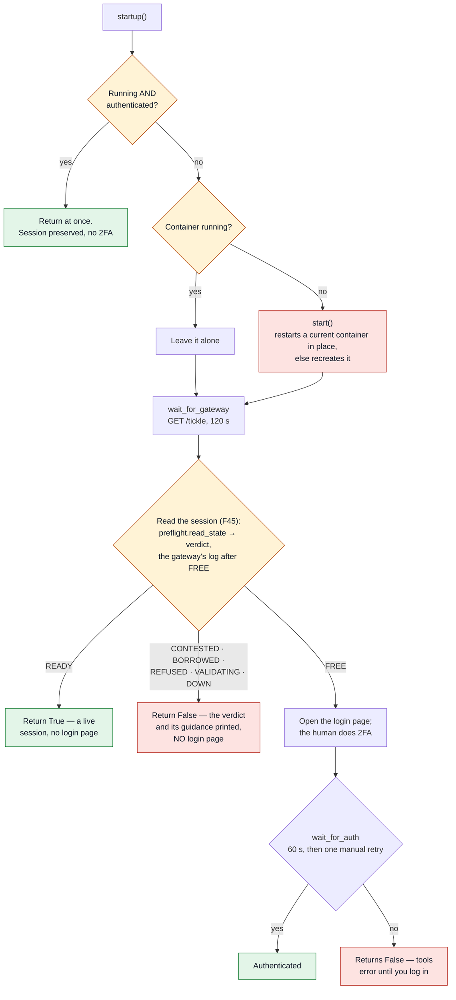
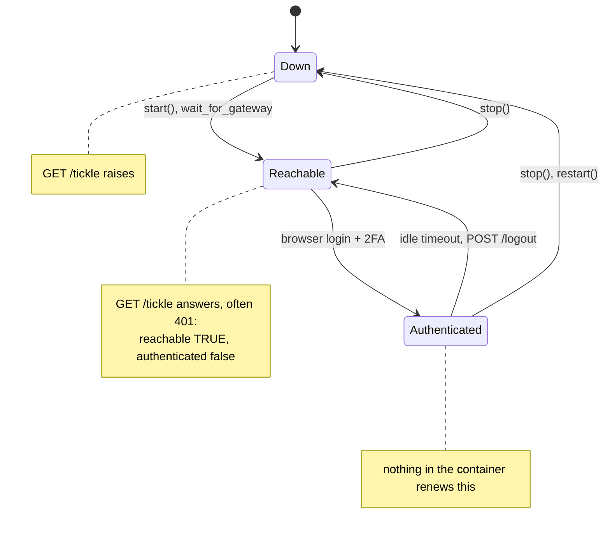
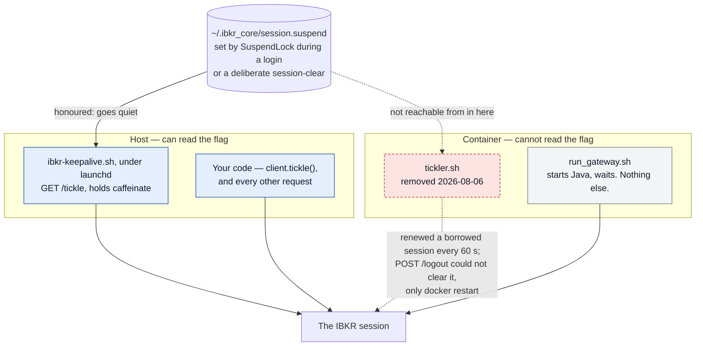

# Gateway Authentication & Session — Full Reference

The IBKR Client Portal Gateway must run on the **same machine** as the browser used to authenticate. No cloud deployment possible.

Three things here have each cost a real debugging session, and each is drawn below because it
is shape, not prose: what `startup()` will and will not destroy, where a session can be, and
which side of the container boundary may renew it.

---

## First login

`BrowserCookieAuth` (default) reads Chrome's cookie store for `localhost`. On first use:

1. Start the gateway using the built-in `GatewayManager` (see below)
2. Open `https://localhost:5055` in Chrome — `GatewayManager.open_login_page()` opens it in a small Chrome
   window of its own (own profile, 540×680); the caller closes it through the returned handle once the
   session is verified, as `startup()` does
3. Log in with IBKR credentials + 2FA (challenge code shown in-browser → IBKR Mobile → enter the response code)
4. Wait for "Client login succeeds" in browser
5. The package reads Chrome's `localhost` cookie when it can. Measured 2026-10-13: the gateway answered
   `/portfolio/accounts` and `/iserver/accounts` with no cookie at all (12 reads, two sessions), and on
   macOS the read can be refused — Chrome's cookie file, "Operation not permitted" — so the client warns
   and continues without one. What a *stale* cookie does is not measured.

**Starting the gateway:**
```python
from ibkr_core_mcp import GatewayManager

gm = GatewayManager()
gm.startup()   # builds Docker image on first run, then opens the login window
```

Or from a script:
```bash
python -c "from ibkr_core_mcp import GatewayManager; GatewayManager().startup()"
```

The gateway Docker image (`ibkr-core-gateway`) is built from assets bundled
inside `ibkr_core_mcp/gateway/`. No external repo is required.

For headless use (ML batch jobs), pass a pre-extracted cookie string:
```python
from ibkr_core_mcp import IBKRClient, TokenAuth, Config

client = IBKRClient(Config.from_env(), auth=TokenAuth("cookie_string_here"))
```

---

## What `startup()` will and will not destroy



The two diamonds are the whole point. `start()` always ends on a fresh Java process, and the
session lives in that process — so calling it throws the session away and forces a fresh 2FA.
Until 2026-08-06 it ran on **every** launch where the gateway was not already authenticated,
discarding sessions a pre-flight would have found perfectly usable. A container that is absent
or stopped cannot hold a session, so starting one loses none; a *running* one is left alone.

**Restarted in place, or recreated (register F43, 2.2.0).** A container that runs the image the
tag names now and was made with the manager's own run options is restarted in place —
`docker restart` starts a stopped container and gives a running one a new process (measured
2026-11-07 on a throwaway container, then seen on the gateway's own) — so its own files survive,
the gateway's log among them: the one place a login IBKR refused shows (claudia_ui gap #93). `start()` records its run options on the container as the
label `ibkr-core-mcp.run-options`; a container on another image, made with other options (a
port, the loopback binding, a variable) or without the label — every one made before 2.2.0 — is
removed and run anew, as is one Docker will not restart. Docker Compose decides the same way: it
recreates a container when "the service's configuration or image was changed after the
container's creation" ([compose up](https://docs.docker.com/reference/cli/docker/compose/up/)).
`restart()` is `start()`.

**The gate before the login page (register F45, step 1, 2026-11-09).** `is_authenticated`
cannot tell "nobody has logged in" from a login IBKR refused, a session another IBKR app holds
(`competing`), a session the gateway is holding *for* another app (the 2026-08-05 borrowed
session), or a login IBKR is still answering — every one reads `authenticated: false`. Until
F45 `startup()` opened the login page on all of them, and on three of the four that is the
wrong move: a needless re-login is what escalates into the IB Key challenge, a login on a
contested session starts the tug-of-war, and a refused login needs a website login first. So
once the gateway answers, `startup()` reads the session the way `python -m ibkr_core_mcp.gateway
preflight` does — `preflight.read_state` (GET `/tickle`, GET `/sso/validate`), `verdict`, and
after a FREE reading the gateway's own log (`manager.read_login_events`) — and acts on the
verdict: **READY** returns `True` at once; **CONTESTED, BORROWED, REFUSED, VALIDATING**, and a
gateway that stopped answering between the wait and the read, print the `[WORD] headline` and
the guidance and return `False` with **no login page**; only **FREE** goes on to the page. The
runbook below says what each verdict asks of you. Step 2 of F45 replaces this body with the
session owner's own sequence, which polls the login to completion instead of asking for Enter.

**A rebuild is not automatic.** `start()` builds the image only when it is absent, so after
changing anything that ships into it (`Dockerfile`, `conf.yaml`, `run_gateway.sh`,
`healthcheck.sh`) you must `docker rmi -f ibkr-core-gateway` first — a restart alone keeps
running the old image. That is exactly how the in-container tickler survived its own removal for
a day. `-f` because the container still uses the image: Docker refuses without it, stopped
container or not ("must be forced", measured 2026-11-07 on a throwaway image), and with it removes
only the tag. The next `start()` then finds no image under the tag: it removes the container,
builds the image and runs a new one. The old image stays on disk, untagged, until it is removed
(`docker image prune`).

---

## Where a session can be



**Reachable is not authenticated, and 401 is good news.** `is_gateway_reachable` counts any
status from 200 to 599 as up: a 401 means the Java process is answering and holds no session,
which is the best possible moment to log in. Treating it as "down" told a user to start a
gateway that was running perfectly (measured 2026-08-05).

**An idle timeout lands you in `Reachable`, not `Down`.** The container is still up and the
port still answers; only the session is gone. That is a browser login away, not a restart.

Both probes are **GET**, not POST, since 2026-08-06: `/tickle` is documented as "pings the
server to prevent the session from ending", so a POST is a session-affecting write dressed as a
health check — and `wait_for_gateway` calls it in a loop. Merely asking "is it up?" renewed the
keepalive timer, which is the exact traffic the suspend flag below exists to stop.

---

## Keeping the session alive



**The session expires without activity, and nothing in the container renews it — you must run
your own keepalive.** This page said the opposite until 2026-08-07: that a bundled `tickler.sh`
POSTed `/tickle` every 60 s so callers did not need one. That was the reassuring half of the
claim, and a caller who believed it ran no keepalive and watched sessions expire with nothing to
explain why. The in-container tickler was removed on 2026-08-06 and the script deleted on
2026-08-07; the same false claim was corrected in `gateway/__init__.py` on 2026-08-06 and this
page was missed.

Renewal cannot live in the container, and the diagram is the reason: the flag that coordinates a
login or a deliberate session-clear is `~/.ibkr_core/session.suspend`, written host-side by
`claudia/gateway_session.py :: SuspendLock`, and nothing inside the container can read it. IBKR
renews a session on **any** request, not just `/tickle`, so one un-silenceable renewer defeats
every attempt to clear a session — on 2026-08-05 three such ticklers renewed a **borrowed**
session every 60 s, and `POST /logout` could not clear it, only `docker restart` could.

Call `client.tickle()` from the host, and pause it while a login is in flight. claudia_ui does
this with `scripts/ibkr-keepalive.sh` under launchd (`RunAtLoad` + `KeepAlive`, installed by
`scripts/install-ibkr-keepalive-daemon.sh`); it honours the suspend flag and holds the
`caffeinate` assertion that stops the Mac sleeping the session away. **If that daemon is not
installed, nothing renews an idle session.**

---

## When a login will not take

Three sections that each cost a real debugging session on the consumer's side, moved here with
register F45 (2026-11-09) because the readings, the rule and the command line that act on them
now live in this package. The consumer's page points at these.

### A borrowed session — the login that could not succeed (diagnosed 2026-08-05)

For days, the gateway login failed with a correctly-formatted 8-digit IB Key response and
the right username, while IBKR Mobile logged in on demand. The cause was not 2FA at all.

**`/tickle` alone could not see it, and every field it does expose pointed the wrong way:**

| Signal | Reading | What it suggested | Why it was wrong |
|---|---|---|---|
| `userId` | populated | a good session | SSO was valid — but not *ours* |
| `ssoExpires` | renewing | session alive | kept alive by our own ticklers |
| `competing` | **false** | uncontested | the gateway never got far enough to register a claim; the flag describes a fight, and there was no fight |
| `authStatus` | `authenticated:false, connected:false` | just log in again | the retry was doomed before it started |

**`GET /sso/validate` answered it in one field:**

```text
CLIENT_APP : IBKRMOBILE_000.a-000      ← the phone's session, held by the gateway
USER_NAME  : ibkruser
RESULT     : True
```

Only one brokerage session exists per username across Client Portal, TWS and IBKR Mobile
([multiple sessions](https://www.interactivebrokers.com/docs/web-api/authentication/multiple-sessions.md)).
The gateway was holding a session **issued to the phone**, which it cannot authenticate as
— so the login page rejected a correct code however often it was retried. `preflight` reads
this as `[BORROWED] SSO session belongs to IBKRMOBILE_…` (exit 4), and `startup()` opens no
login page on it.

Two follow-ons, both measured rather than reasoned about:

- **`POST /iserver/auth/ssodh/init` cannot rescue this.** Twice, it moved `connected`
  False→True and left `authenticated` False. It raises the bridge; it cannot supply an
  authentication that never happened.
- **`POST /logout` returned `{"status": true}` and the session came straight back**, with a
  full 10-minute window. Three independent ticklers renewed it every ~60s — the container's
  own `tickler.sh` (gone since 2026-08-06), the host's launchd keepalive, and the host
  application's connectivity poll (which no longer tickles; the 60 s read is the session
  owner's). **The keepalive built to protect a good session cannot tell a good session from a
  borrowed one**, and had been preserving an unusable one all day. **The three-tickler
  explanation is not sufficient — measured again 2026-09-10 with the container tickler gone
  and the host application stopped:** a `POST /logout` still returned `{"status": true}` and
  cleared nothing, and the session still came back with a full ~10-minute window. Treat
  `POST /logout` as unable to clear a *borrowed* session at all — it is another client's SLS
  session, not the gateway's to end — and go straight to the container restart.

**What resolved it: `docker restart`.** The session is held in the gateway's local process
memory, not re-served from IBKR, so a restart drops it with nothing to race. Login then
succeeded first time, and `/sso/validate` came back `CLIENT_APP: None` — the session
belonged to the gateway itself. That is what `python -m ibkr_core_mcp.gateway reset` does
(F45 step 2; until it ships, `docker restart ibkr_core_gateway` by hand after reading
`preflight`). Four theories died before this one: a stale gateway build (SHA-256 identical to
a fresh download), a wrong `ip2loc` (IBKR's own shipped default), an IB Key registered to
another username (same username, user-confirmed), and 2FA itself.

### Refused after "Client login succeeds" (2026-10-07/08)

Five logins in a row completed in the browser, and the page read *"Client login succeeds"*.
Yet the preflight read `[FREE]`, `/tickle` answered 401 to every caller, including Chrome's
own request with its cookie, and the keepalive never logged `OK`. **The container's stdout
showed nothing; the gateway's internal log showed everything:**

```bash
docker exec ibkr_core_gateway sh -c 'ls /app/api_gateway/logs'   # gw.<YYYY-MM-DD>.log, UTC times
```

```text
GatewayHttpProxy : Client login succeeds
BaseServiceProxy : -> GET /v1/api/sso/validate?gw=1,401
BaseServiceProxy : failed /v1/api/sso/validate?gw=1 | reason Access Denied
GatewayHttpProxy : authentication to cp failed, retry 1   … retry 5
GatewayHttpProxy : giving up ...
```

The gateway labels an **upstream** 401 "Access Denied" (read in its own code), so IBKR's side
refused the gateway's validation of a login that had just succeeded. A good login reads
`sso/validate?gw=1,200` → `authenticated to cp` → `ssodh/init` 200 → `tickle,200`.

**What cleared it (2026-10-08 12:15 EDT): one login on IBKR's website in Chrome, a log-out,
then one gateway login.** The validation passed at once, and a direct gateway login the same
afternoon (16:35 EDT) was validated at the first attempt. This matches Voyz/ibeam #267 and the
ibeam wiki's "Authentication loop", where IBKR-side refusals of this kind are reported as
sporadic and the website login can raise an extra identity confirmation that the gateway
never shows. **IBKR's reason is not visible to us and is not established.** Ruled out by
evidence: our code, the gateway image, macOS, and cookies. The log carries the username, a
numeric user id, cookies, tokens and device identifiers; redact before sharing.

**The package reads that log for you.** One read — `docker exec ibkr_core_gateway grep -rHF
--include=gw.[0-9]*.log -e <phrase>… /app/api_gateway/logs`, no shell, an explicit environment
(`gateway.manager.read_login_events`) — and only the time, the event and its code survive it;
no line of the log is printed or stored. The rule (`preflight.last_login`): take the last
*"Client login succeeds"* in the container's logs, whatever its age — *"giving up"* after it
and no *"authenticated to cp"* means refused; neither yet means IBKR is still answering. The
page writes *"Client login succeeds"* one second **before** IBKR is asked, so it is not a
session. A restart did not clear one (2026-10-08: the container started 15:47:49 UTC, the
next login was refused at 15:49:37). Since register F43 `start()` restarts a current container
in place, so the log survives a start; a container that is removed and re-created loses its
log, and with it the evidence. Where it shows: `preflight` reads `[REFUSED]` (exit 5) or
`[VALIDATING]` (exit 6); `startup()` opens no login page on either; the session owner (F45
step 2: `up`, a host's button) names a refused last login before the page opens and ends the
wait at once if the new login is refused too; `diagnose` prints the login timeline. Checked
against every login on record, 2026-10-07 → 10-13: five refused, five validated, and two
*"giving up"* episodes with no login that are not refusals.

### Runbook: a login that will not take

```bash
python -m ibkr_core_mcp.gateway preflight     # ALWAYS first — read-only: two GETs, then (after FREE) one read of the gateway's log
```

| Verdict | Exit | What it means | Do this |
|---|---|---|---|
| `[OK] Session is LIVE` | 0 | already authenticated | **Nothing.** A needless re-login is what escalates into the IB Key challenge |
| `[DOWN] Gateway is NOT answering` | 1 | no usable HTTP response | start the container |
| `[FREE] …` | 2 | nothing holds the slot | log in now, through to *"Client login succeeds"* |
| `[BUSY] Another IBKR client holds the session` | 3 | `competing`/`collision` set | fully close the other client, re-check |
| `[BORROWED] SSO session belongs to X` | 4 | the gateway holds another app's session | log out of X **from its Log Out menu item**, then `python -m ibkr_core_mcp.gateway reset` (F45 step 2; `docker restart ibkr_core_gateway` by hand until then) |
| `[REFUSED] IBKR refused the last gateway login (…)` | 5 | the gateway's own log: IBKR refused its validation of the last login | **one login on IBKR's website in your browser, then log out, then one gateway login.** Not another gateway login first, not a restart |
| `[VALIDATING] IBKR has not answered the last login yet (…)` | 6 | the last login is still being validated (a refusal took up to 13 s, measured) | **nothing** — do not log in again; re-run in a few seconds |

Closing or swiping an app away is **not** logging out — IBKR's own gateway walkthrough
warns it *"may cause a stale login session"*, which is precisely the state above.

`python -m ibkr_core_mcp.gateway reset` (F45 step 2) restarts the container and re-checks. Its
guard sits inside `GatewayManager.start()` itself, where the restart happens, not in the command:
a **live** session is refused (`--force` overrides) — a tool built to fix a login must not be
able to break one — and so are `[REFUSED]` and `[VALIDATING]`: a restart did not clear IBKR's
refusal on 2026-10-08, and it would cut off a login IBKR is still answering.

**HTTP 401 is not a failure.** It is the gateway answering that it holds no session — a
freshly started or freshly logged-out gateway, and the best possible moment to log in.
`read_state` treats it as `reachable=True`; folding it into `reachable=False` once produced
*"Gateway is NOT answering. Start it first"* about a gateway that was running perfectly and
waiting (fixed 2026-08-05, pinned by `test_a_401_means_alive_and_ready_not_down`, with a
sibling test proving the carve-out still reports a genuine outage as DOWN).

**A login IBKR refused reads `[REFUSED]`, not `[FREE]`**: after a `FREE` HTTP reading the
preflight reads the gateway's own log (§ Refused after *"Client login succeeds"*). Until
2026-10-12 it could not tell a refused login from no login: during the 2026-10-07/08 incident
it read `[FREE]` ("a login can proceed") between refused logins. When the log cannot be read,
`[FREE]` says so on its last line — a refused login would then not show, and
`python -m ibkr_core_mcp.gateway diagnose` is the next step.

---

## Rate limits

IBKR's documented global limit is **10 requests/second** for any endpoint not in its
per-endpoint table (several are far stricter — `/iserver/account/orders` and
`/iserver/account/trades` are 1 req/5s, `/pa/*` and `/iserver/scanner/params` are 1 req/15
mins, `/tickle` is 1 req/s). Exceeding a limit returns HTTP 429 and puts the **IP** in a
fifteen-minute penalty box that applies to every endpoint, not only the one that broke the
limit. Repeat violators can be blocked permanently.

`rate_limiter.py` now does two things:

- **`EndpointPacer` paces proactively**, before the request goes out, against a sliding
  window per endpoint. The limits live in `rate_limiter.ENDPOINT_LIMITS` — one executable
  table, deliberately with no second table in prose, because the prose copy is what went
  stale (see below). The per-tool one-line rate-limit notes in `docs/tools-reference.md` and
  `docs/api-reference.md` restate single rows and are the copies to check when the table
  changes: the history endpoint's still read "5 concurrent requests" in both files and in
  `client.py`'s docstring until 2026-09-17, a day after the table itself was corrected.
  Ordinary spaced-out usage never waits.
- **`with_retry` reacts**, retrying 429/503 with exponential backoff (1s, 2s, 4s over 3
  attempts) and raising `IBKRRateLimitError` if still failing. Each retry goes back through
  the pacer before it is sent — a retry is a request too; until 2026-09-17 only the first
  attempt was paced and the window never saw the others (API-R8).
- **One budget per path.** The table is keyed by (path, method) as IBKR's is; a path
  listed under two verbs pools every verb's limits into one bucket, the stricter window
  binding. Deliberate: separate buckets would be right if IBKR counts the verbs separately
  and would earn the penalty box if it does not, while pooling costs at most one needless
  wait (API-R11).

Until 2026-09-16 only the second existed, while this file and two others described the
first. It was not academic: `get_market_history_paginated` was measured issuing chunk
requests at **284/minute** against a published ceiling of 50, and its 120-chunk guard would
have completed in ~25 seconds — 2.4x a minute's allowance inside half a minute — against a
reactive retry budget of seven seconds.

**The pacer's budget is per process; IBKR's limit is per IP.** Nothing is shared between
interpreters, so several processes can each stay inside the limit while together breaking
it. Demonstrated on 2026-09-16: a run of short-lived probe scripts against the live gateway,
each starting with an empty budget, earned HTTP 429 and the fifteen-minute penalty box
although no single process exceeded 50 requests in a minute. This is how the package is
normally used — a pytest run, a script and an MCP server are three processes on one IP — so
treat it as a real gap, not a corner case. Closing it needs cross-process state and has not
been done. Practical rule: **do not run live suites concurrently, and treat back-to-back
script invocations as sharing one budget.**

**The pacer never blocks longer than `_MAX_PACING_WAIT` (65 s).** The 1-req/15-mins
endpoints are why: blocking a tool call for 900 s would be worse than the 429 being
avoided, and failing the call outright would break a request that succeeds today. Past the
cap it emits a `UserWarning` naming the endpoint and how early the call is, and sends it.

**The per-endpoint table moved into code because the prose copy went stale.** IBKR changed
`/iserver/marketdata/history` from "5 concurrent requests" to "10 req/sec or 50 req/min" at
the 2026-08 documentation move; the link-repointing pass updated the citation URL without
re-reading the page behind it, so the wrong value survived with a correct-looking source
beside it. Re-read and diffed row by row 2026-09-16: 25 of 26 rows agreed, that one did not.
Source: https://www.interactivebrokers.com/docs/web-api/v1/pacing-limitations
